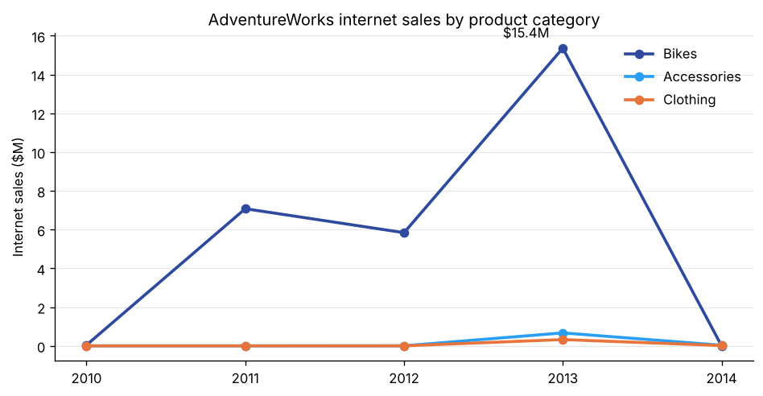
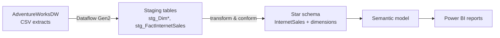
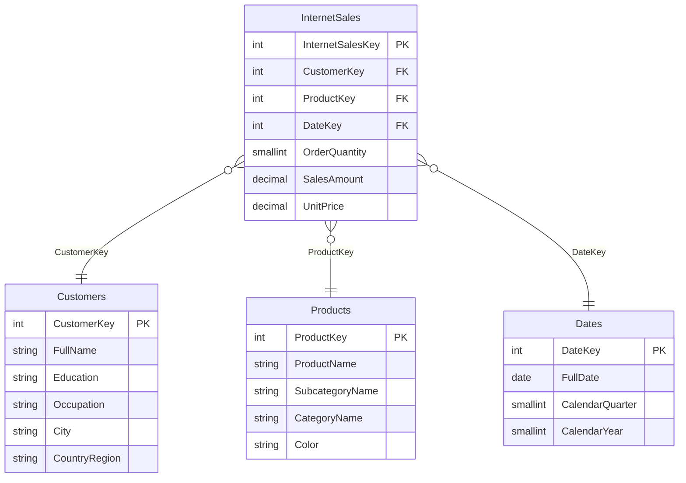
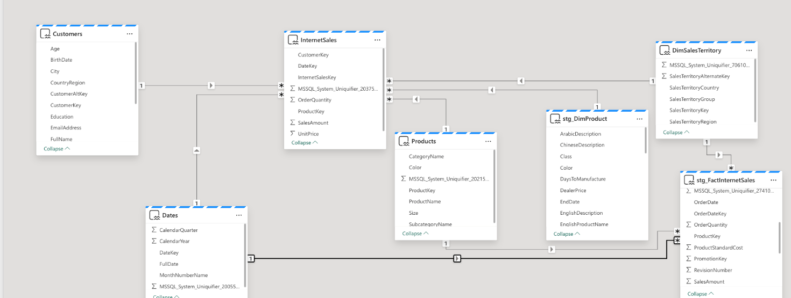

# 🏗️ AdventureWorks Sales Data Warehouse (Microsoft Fabric)

A dimensional data warehouse built in **Microsoft Fabric**: raw AdventureWorks extracts are loaded into staging tables with **Dataflow Gen2**, modeled into a **star schema**, and reported on in **Power BI**.

**Course:** CIS 409 (Business Data Warehousing & Dimensional Modeling), Arizona State University, Spring 2026
**Stack:** Microsoft Fabric (Warehouse, Dataflow Gen2, semantic model) · T-SQL · Power BI



## Architecture



## Star schema



The full semantic model in Fabric, including the sales-territory dimension added for regional reporting:



## What I built

1. **Ingestion:** Dataflow Gen2 jobs that load the AdventureWorks CSVs (customers, products, product categories and subcategories, geography, dates, internet sales) into staging tables.
2. **Dimensional model:** flattened the product hierarchy (product → subcategory → category) and customer + geography into conformed dimensions around a single `InternetSales` fact table.
3. **Analysis in SQL:** multi-table joins across the fact table and the product hierarchy to summarize sales by category and year ([query](sql/analysis/sales_by_category_year.sql), [results](results/sales_by_category_year.csv)).
4. **Power BI reporting:** a sales-by-year line chart, a territory-by-product matrix report, a stacked bar chart by product line, and a bubble chart by sales territory, all built on the Fabric semantic model.

## Key results

| Category | 2010 | 2011 | 2012 | 2013 | 2014 |
|---|---:|---:|---:|---:|---:|
| Bikes | $43K | $7.08M | $5.84M | $15.36M | – |
| Accessories | – | – | $2K | $668K | $30K |
| Clothing | – | – | $1K | $324K | $15K |

- **Bikes drive about 96% of the $29.4M in internet sales.** Accessories and clothing only start selling online in 2012.
- 2013 is the peak year: bike sales grew about 2.6x over 2012, the same year accessory and clothing sales took off.
- 2014 is only a partial year in the sample dataset, so the dip isn't a real decline.

## Repo structure

```
adventureworks-sales-warehouse/
├── sql/
│   ├── staging/         # stg_Dim* and stg_FactInternetSales table definitions
│   ├── star_schema/     # InternetSales fact + Customers, Products, Dates dimensions
│   └── analysis/        # reporting queries
├── results/             # query output
└── images/              # charts and model diagram
```

Table definitions were exported from the Fabric warehouse project. Fabric's internal `MSSQL_System_Uniquifier` columns were removed for readability.

## Data source

[AdventureWorksDW](https://learn.microsoft.com/en-us/sql/samples/adventureworks-install-configure), Microsoft's public sample data warehouse for a fictional bicycle manufacturer.
